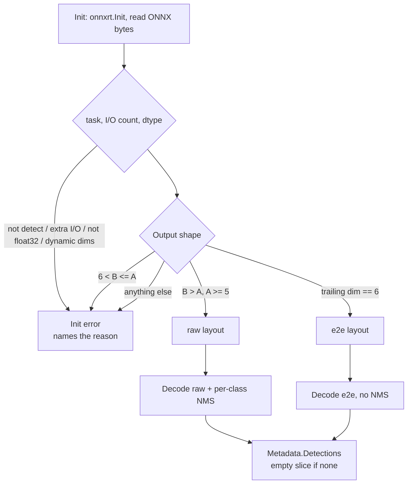

# Design: YOLOv11 and YOLOv26 support

Status: Proposed — not implemented.
Date: 2026-09-18.
Revised: 2026-09-18 (design review; tracking/sports contracts;
second review).
Scope: a generic `yolo` go_processor that replaces the single-purpose
`yolo_v8` node (kept as an alias), a second output decoder for NMS-free
models, model introspection at `Init`, and the matching docs and
examples. Detection only — no tracker inside this processor. Static-shape
float32 ONNX only. Additive contracts so a later tracking node and
small-object sports models are not boxed out: `ClassID` on `Detection`,
empty-vs-skipped metadata, `pad_value` on new `yolo`, and a layout enum
that can grow a third value.

## 1. Summary

Replace the single-purpose `yolo_v8` processor with one generic `yolo`
detection processor that auto-detects the model's output layout from the
ONNX file, and keep `yolo_v8` as a silent permanent alias. YOLOv11
detection models already share the YOLOv8 output layout, so they need
almost no new decode logic. YOLOv26 is NMS-free when exported with
`nms=False` (or `nms=True`, which embeds NMS in-graph) and emits a
different tensor, so it needs a second decoder and a path that skips
NMS.

The work is about 5 small commits. It adds no new Go modules and no
schema changes, because `go_processor` params are free-form. The main
engineering change is reading tensor names, shapes, dtypes and metadata
from the model instead of computing the output shape from `input_size`
and `num_classes`. This processor stays stateless per frame. Tracking,
head pose, speaking, and face identity are a separate design; they
consume `Metadata.Detections` and must not be folded into `Init`/`Process`
here. Faces stay on `face_detect`.

## 2. Background

MediaMolder has one object-detection processor today, `yolo_v8`,
compiled only under the `with_onnx` build tag.

| Piece | Location | What it does |
| --- | --- | --- |
| Decode and NMS | `processors/yolov8.go` | `ParseYOLOv8Output`, `NMS`, `IoU`. Pure Go, no build tag, unit-tested without ONNX Runtime. Missing labels become the string `unknown`. |
| ONNX processor | `processors/yolov8_onnx.go` | `YOLOv8Detector`: letterbox preprocess, fixed-shape `AdvancedSession`, decode, NMS, emits `Metadata.Detections`. Registered as `yolo_v8`. |
| Runtime init | `internal/onnxrt` | Process-global ONNX Runtime init and library discovery, shared with `face_detect`. |
| GUI | `internal/gui/api.go` | Node description string for `yolo_v8`. `internal/gui/curation.go` has no `yolo_v8` entry today, so the node is uncurated. |
| Docs and examples | `docs/yolov8-guide.md`, `docs/go-processor-nodes.md`, `testdata/examples/29`–`32` | User guide, parameter reference, four example graphs. Many other docs still name `yolo_v8` (build pages, specification, README). |

Three properties of the current code block newer models:

- The output tensor shape is computed, not read. `Init` assumes
  `[1, 4+num_classes, (s/8)²+(s/16)²+(s/32)²]` and pre-allocates a
  tensor of that shape. Any other layout fails at session creation with
  an opaque shape error.
- NMS is unconditional and class-agnostic. A box of one class can
  suppress an overlapping box of another class.
- `num_classes` defaults to 80 and must be set by hand for custom
  models, although the model file already records it.

The `face` package already has two YOLOv8-face decoders that match the
layouts below: `parseYOLOv8FaceOutput` (raw, transposed) and
`parseYOLOv8FaceNMSOutput` (end-to-end, row-major) in `face/face.go`.
That is the in-repo precedent for the decode split. It is **not** a
precedent for model introspection: `face/analyze_onnx.go` still picks
the layout from a hardcoded `ModelSpec.MaxDet` flag and computes
`numPreds` with the same `(s/8)²+(s/16)²+(s/32)²` formula. Face also
already reads the ONNX file once and uses the `…WithONNXData` session
constructors; this plan copies that load path, not the layout heuristic.

### 2.1 FFmpeg reference

FFmpeg's `libavfilter/vf_dnn_detect.c` supports only anchor-based YOLO
(`model_type` = `yolo`, `yolov3`, `yolov4`) and requires an `anchors`
option. It has no decoder for the anchor-free heads used from YOLOv8
onward, so there is no C decode logic to port for v11 or v26. Two of its
behaviours are still worth adopting:

- NMS is per label. `dnn_detect_fill_side_data` suppresses a box only
  when the labels match
  (`strcmp(bbox->detect_label, overlap_bbox->detect_label)`).
- A missing label falls back to the numeric class id, not the string
  `unknown` (`snprintf(..., "%d", label_id)` in
  `dnn_detect_fill_side_data`).
- End-to-end / SSD-style class ids are truncated with a bare
  `(int)detections[i * detect_size + 1]` (local FFmpeg tree,
  `libavfilter/vf_dnn_detect.c` around the SSD post-process). There
  is no `dnn_detect_label_id_from_float`, and FFmpeg does not check
  finite or non-negative before the cast.

MediaMolder still truncates with `int(class_id)`, matching FFmpeg.
The NaN, Inf, negative, and overflow skips around that cast are
**MediaMolder additions**: Go's conversion of those values to `int` is
implementation-defined, so they must not reach the conversion.

FFmpeg also reuses the confidence threshold as the IoU threshold inside
`dnn_detect_fill_side_data`. That is not copied: MediaMolder keeps the
existing separate `iou` param, matching Ultralytics.

## 3. What differs between the models

Only the output layout matters to MediaMolder: the backbone and neck
changes are inside the ONNX file. There are two layouts to support, and
the layout depends on how the model was exported, not only on its
version.

| Model | Released | Detection output (640 input, COCO) | NMS needed | Notes |
| --- | --- | --- | --- | --- |
| YOLOv8 | Jan 2023 | `[1, 84, 8400]` raw, transposed | Yes | Supported today. |
| [YOLO11](https://docs.ultralytics.com/models/yolo11/) | Sep 2024 | `[1, 84, 8400]` raw, transposed | Yes | New backbone and neck; same head layout as v8. Sizes n/s/m/l/x. |
| [YOLO26](https://docs.ultralytics.com/models/yolo26/), one-to-many head | Jan 2026 | `[1, 84, 8400]` raw, transposed | Yes | Exported with `nms=None`. DFL removed, but the decoded tensor has the v8 layout. |
| YOLO26, one-to-one head | Jan 2026 | `[1, 300, 6]` end-to-end | No | Exported with `nms=False`. Rows are `[x1, y1, x2, y2, confidence, class_id]`. |
| Any detect family, embedded NMS | — | `[1, max_det, 6]` end-to-end | No | Exported with `nms=True`. Same row layout and zero-confidence padding as `nms=False`. The shape alone does not identify which head was exported. `max_det` defaults to 300 but is an export setting. |

Layout definitions, called **raw** and **e2e** below:

- **raw**: `[1, 4+nc, N]`. Attribute `j` of prediction `i` is at
  `raw[j*N + i]`. Box is `cx, cy, w, h` in model-input pixels. Needs a
  best-class search, confidence filter and NMS.
- **e2e**: `[1, max_det, 6]`. Row-major, one detection per row. Box is
  `x1, y1, x2, y2` in model-input pixels. Already de-duplicated; rows
  past the last real detection have confidence near 0. Needs only a
  confidence filter and the letterbox reverse-mapping. Used for both
  `nms=False` (one-to-one head) and `nms=True` (NMS in-graph).

The export flags are from the
[Ultralytics export reference](https://docs.ultralytics.com/modes/export/)
and the
[end-to-end detection guide](https://docs.ultralytics.com/guides/end2end-detection/).
That page now lists raw as the default for `nms`, but YOLO26 files
exported with earlier Ultralytics releases are e2e, and YOLOv10 files
share the e2e layout. Users will arrive with both, which is the main
reason to auto-detect.

Both model families also ship segmentation, pose, OBB and classification
variants, and YOLO26 adds semantic segmentation and depth. Those heads
are **not implemented in this work** and must fail at `Init` (section
5.1). The layout enum and `DetectYOLOLayout` are written so a later
commit can add a third value rather than forking the processor.
Section 5.3 orders the checks so a sports 1-class e2e export with a
small `max_det` (`[1, 5, 6]`, `[1, 6, 6]`) is e2e, not raw, and so
`B > 6` is not used as the pose/OBB test (that would also match
`[1, 84, 8400]`).

Shape heuristics alone are not enough for raw non-detect: a YOLO11-seg
`output0` is `[1, 4+nc+32, 8400]` (COCO: `[1, 116, 8400]`), which matches
the raw rule with an inflated `nc`. `task` metadata, tensor count, and
`names` vs `nc` close that hole (section 5.1).

## 4. Goals and non-goals

Goals:

- Run YOLO11 and YOLO26 detection models, in either export layout,
  including `nms=True` embedded-NMS exports, with no parameters beyond
  `model`.
- Keep every existing `yolo_v8` graph working unchanged, with identical
  detections — boxes, scores, NMS, and label strings.
- Fail at `Init` with a message that names the actual reason (output
  shape, `task` metadata, tensor count, or dtype) when the model is not
  a static-shape float32 detection export.
- Keep all decode logic in pure Go without a build tag, so it is tested
  in the default `go test ./...` run.

Non-goals:

- Implementing segmentation, pose, OBB, classification, semantic
  segmentation or depth **in this work**. `Init` still rejects them.
  The decoder split must remain extensible (a third `YOLOLayout` value,
  wider e2e last-dim) so a later PR does not rewrite the processor.
  YOLO-pose is body keypoints and is the wrong tool for face orientation;
  that stays in `face`.
- A tracker inside this processor (ByteTrack, OC-SORT, or Ultralytics'
  AGPL tracker). Detectors stay stateless and unit-testable without a
  time axis. `Detection.TrackID` remains unused here; a downstream
  `object_track` node fills it.
- Folding `face_detect` into `yolo`. Face tensors are 21 attrs with
  landmarks. If the face backbone later becomes YOLO11-face / YOLO26-face,
  that change lives in the `face` package.
- Batch sizes above 1, and `dynamic=True` exports on **new `yolo`**
  (input size that changes per frame, or dims reported as -1). Users
  re-export without `dynamic=True`. The `yolo_v8` alias keeps the
  formula fallback so existing dynamic graphs still `Init`.
  `AdvancedSession` with bound tensors stays; this plan does not
  introduce `DynamicAdvancedSession`. Stadium wides that need multi-res
  use tiling later, not dynamic shapes. Rectangular `imgsz` is rejected
  (square preprocess).
- FP16 / INT8 ONNX. Reject at `Init` with the dtype named.
- Bundling or downloading model weights (see section 8).
- New inference backends. ONNX Runtime stays the only one.
- Changing the existing `Letterbox` helper (black pad, nearest-neighbour).
  Face and current tests depend on it. New `yolo` gets its own preprocess
  path with `pad_value` (default 114) and bilinear resize; the `yolo_v8`
  alias keeps pad 0 and nearest so detections stay bit-identical.

## 5. Design

One processor, `yolo`, selects a decoder by output layout rather than by
model version. Version-named processors would multiply (`yolo_v11`,
`yolo_v26`, then v10, v12 and whatever ships next) while the code
underneath has only two paths.



Both decoders share the letterbox reverse-mapping, clamping and label
lookup, and both emit `Detection` (now with `ClassID`; see §5.3).
Downstream consumers that only read `Label` / `BBox` / `Confidence` see
no change. `metadata_file_writer` gains an additive `class_id` field.

### 5.1 Model introspection

`Init` uses APIs the pinned `github.com/yalue/onnxruntime_go v1.28.0`
already provides. `GetInputOutputInfo` and `GetModelMetadata` require
`InitializeEnvironment()` first, and `ModelMetadata` must be
`Destroy()`ed. The sequence is:

1. `onnxrt.Init` (same as today; must happen before any I/O-info call).
2. `os.ReadFile` once. YOLO26x is a few hundred MB; three session loads
   of that at `Init` is not acceptable even as a once-per-graph cost.
   `face/analyze_onnx.go` already reads bytes once and uses the
   `…WithONNXData` constructors. If ORT refuses the bytes because the
   model uses external data, stop with an error that names the sibling
   `.onnx.data` (or equivalent) and asks for a single-file export — do
   not fall through to the path APIs in this work.
3. `ort.GetInputOutputInfoWithONNXData` and
   `ort.GetModelMetadataWithONNXData` on those bytes.
   `defer metadata.Destroy()`.
4. Validate, then allocate float32 tensors from the real shapes.
5. `ort.NewAdvancedSessionWithONNXData` with those tensors. CUDA
   session options are built exactly as today; introspection itself
   runs on CPU and needs no provider.

From the I/O info and metadata the processor takes:

- Input and output tensor names, replacing the `images` and `output0`
  defaults. `input_name` and `output_name` stay as overrides, but they
  only rename the bound tensors — they do not let a multi-output model
  through.
- Input size, from an input of `[1, 3, S, S]`. `input_size` stays as a
  cross-check: if given and it disagrees with `S`, `Init` fails.
- Output shape, which sets the layout, `nc` (raw: dim 1 minus 4) and `N`
  or `max_det`. This removes the `(s/8)²+(s/16)²+(s/32)²` formula, which
  is wrong for input sizes not divisible by 32.

`Init` fails, naming the actual values, when any of these hold:

| Check | Fail when |
| --- | --- |
| Tensor counts | Not exactly one input and one output. Segmentation's proto tensor is the usual extra output. |
| Dtype | Input or output is not float32 (`half=True` / INT8). |
| `task` metadata | Key `task` is present and not `detect`. |
| Dynamic dims | New `yolo`: any input or output dim is -1, or `GetInputOutputInfo` errors because the shape is not concrete. Message tells the user to re-export without `dynamic=True`. The `yolo_v8` alias treats **both** outcomes as the trigger for today's `input_size` / `num_classes` formula (the I/O-info call erroring, **or** dims coming back as -1). Do not return the I/O-info error before the fallback; otherwise a `dynamic=True` v8 graph that already works dies at `Init`. Then bind static tensors as today. |
| Batch | Input or output batch dim is not 1. |
| Rank / layout | Output is not rank-3, or `DetectYOLOLayout` rejects it. A `layout` override that disagrees with the shape also fails. |
| Square input | Input is `[1, 3, H, W]` with `H != W`. Today's preprocess assumes a square. |
| `num_classes` param | Given and disagrees with inferred `nc`. |
| `names` vs `nc` | Raw layout only: `names` parsed successfully, and `len(names) != nc`. This is what stops a stripped-of-`task` YOLO11-seg `output0` of `[1, 116, 8400]` from looking like a 112-class detector when the file still carries 80 COCO names. E2e has no `nc` in the shape (see §5.2). |
| External data | `WithONNXData` fails because the model has a sibling `.onnx.data` (or similar). `Init` error names the file and tells the user to re-export a single-file ONNX. |

Residual hole: a pose or OBB export with `task` and `names` stripped,
a single output, and float32 raw-shaped tensors will still look like
detect. That is accepted; Ultralytics files carry `task`.

### 5.2 Labels from model metadata

Ultralytics exports embed the class names in the ONNX custom metadata
under the key `names`, as a Python-dict string such as
`{0: 'person', 1: 'bicycle'}`. The parser is a small tolerant reader in
pure Go, not `eval`. The string comes from an untrusted file: cap input
at 1 MiB. Cap entries at `maxEntries` and reject indices outside
`[0, maxEntries)`:

- raw: `maxEntries = nc` (dim 1 minus 4).
- e2e: the shape has **no `nc`**. `maxEntries = 10_000`. After a
  successful parse, `nc` for cross-checks is `len(names)`. If the user
  passed `num_classes` and names parsed, disagreement with `len(names)`
  fails `Init`. If names did not parse, `num_classes` on e2e is ignored
  (there is nothing to check).

Do **not** pre-fill a numeric label slice. New `yolo` looks up
`labels[ClassID]` when `0 <= ClassID < len(labels)`, else
`strconv.Itoa(ClassID)` at decode time. That works for a 1-class e2e
head whose `class_id` is 0 and for a `class_id` past the name list.

`ParseYOLOv8Output` is not changed. It still emits `"unknown"` when the
label slice is short or empty (`TestParseYOLOv8Output_UnknownLabel`).
The alias keeps calling it as today.

| Case | `yolo_v8` alias | `yolo` |
| --- | --- | --- |
| `labels_file` set | file (unchanged) | file, then `Itoa` on a miss |
| no file, `names` in model | do not read metadata; keep `"unknown"` | parse `names`, then `Itoa` on a miss |
| no file, no or failed `names` | `"unknown"` | `strconv.Itoa(ClassID)` |

A `names` parse failure on `yolo` is not an `Init` error.

### 5.3 Decoders

A new untagged file `processors/yolo.go` holds the pure-Go logic:

```go
type YOLOLayout int

const (
	YOLOLayoutRaw YOLOLayout = iota // [1, 4+nc, N], needs NMS
	YOLOLayoutE2E                   // [1, maxDet, 6], NMS-free
)

func DetectYOLOLayout(outShape []int64) (YOLOLayout, error)
func ParseYOLOE2EOutput(raw []float32, maxDet, inputSize int, confThresh float64, labels []string, origW, origH int) []Detection
func NMSPerClass(dets []Detection, iouThresh float64) []Detection
```

`YOLOLayout` is an iota so a later commit can add `YOLOLayoutPose` /
`YOLOLayoutOBB` without renaming the detect values.

`Detection` gains an integer class id. `Label` stays the display string;
tracking and per-class NMS key off `ClassID` when it is `>= 0`. Class 0
is a real COCO id (`person`), so the sentinel for “no class index” is
**-1**, not 0, and the field cannot use `json:",omitempty"` (that would
drop class 0).

```go
type Detection struct {
	Label      string     `json:"label"`
	ClassID    int        `json:"class_id"` // -1 = none; 0 is a valid class
	Confidence float64    `json:"confidence"`
	BBox       [4]float64 `json:"bbox"`
	TrackID    int        `json:"track_id,omitempty"`
}
```

Go's zero value is 0, which would mark every existing producer as
COCO `person`. Commit 2 therefore:

- has both YOLO decoders set `ClassID` to the winning / truncated
  index (`>= 0`);
- sets `ClassID: -1` in the two other composite literals:
  `processors/face_detect.go` (label `"face"`, no index) and
  `processors/vidi_analyzer.go` (free-text Vidi labels). Without that,
  a tracker keyed on `ClassID` would merge every Vidi box into class 0.

`NMSPerClass` is only called on YOLO output, where `ClassID >= 0`.
`TrackID` stays unused in this processor. JSON sidecars gain
`class_id`; boxes, scores, labels and NMS stay identical for the alias.

- `ParseYOLOv8Output` stays as the raw decoder, with its name,
  signature, and `"unknown"` fallback kept because it is exported and
  because the alias depends on that string. It also sets `ClassID` to
  the winning class index (additive; existing tests that ignore the
  field still pass). The letterbox arithmetic moves into a shared
  unexported helper used by both decoders. The helper copies the
  **current float reverse-mapping** in `ParseYOLOv8Output`
  (`offset = (inputSize - round(orig*scale)) / 2.0`). It does not
  switch to `Letterbox`'s integer `(targetW-newW)/2` pad. Those two
  already disagree by half a pixel on odd pads; "fixing" the reverse
  mapping would move boxes and break identical detections. Face's
  `unletterbox` already matches the float reverse.
- `ParseYOLOE2EOutput` reads row `i` at `raw[i*6 : i*6+6]`, drops rows
  below `conf`, and maps `class_id` by truncation to `int` after
  MediaMolder's extra guards: skip the row unless the value is finite,
  non-negative, and `< 10_000` (the same cap as the e2e `names` parser).
  Do not use `<= math.MaxInt`: `float64(math.MaxInt)` rounds up to
  `2^63`, so a value of exactly `2^63` would pass and overflow on
  `int()`. Go's conversion of NaN/Inf to `int` is
  implementation-defined; FFmpeg itself does a bare `(int)`
  cast with no such check. `1.0` and `1.0000001` both become class 1;
  `1.9` becomes 1. `ClassID` is that truncated index. Label is
  `labels[ClassID]` or `strconv.Itoa(ClassID)` on a miss — never a
  pre-filled `"0".."n"` slice, never `"unknown"` from this decoder.
  NaN/Inf boxes and scores are skipped.
- `DetectYOLOLayout` on a rank-3 shape `[1, A, B]` with no -1 dims,
  **in this order** (raw `N` is at least 21 even at `S=32`, so `B == 6`
  cannot be a raw prediction count):
  1. `B == 6` → e2e. Includes `[1, 300, 6]`, `[1, 5, 6]`, `[1, 6, 6]`,
     `[1, 1, 6]`.
  2. Else `B > A` and `A >= 5` → raw. Includes `[1, 84, 8400]` and
     `[1, 6, 8400]` (2-class raw).
  3. Else `6 < B && B <= A` → error that names the shape as unsupported
     pose/OBB (e.g. `[1, 300, 56]`). Not a generic unknown layout.
  4. Else reject (rank 2, rank 4, batch ≠ 1, any -1 dim, leftover
     rank-3).
  The previous “`B == 6` and `A != 6` / `B > 6` means pose” split is
  wrong: `[1, 5, 6]` matched both rules, `[1, 6, 6]` was rejected
  though it can only be e2e, and “`B > 6`” also matches `[1, 84, 8400]`.
  The `layout` param overrides detection only when the ordered rules
  still match that layout; otherwise `Init` fails.

### 5.4 NMS behaviour

New `yolo` nodes use per-class NMS, matching FFmpeg's `dnn_detect` and
the Ultralytics default. Suppression keys off `Detection.ClassID`, not
`Label`. Duplicate display names therefore still NMS separately, and
numeric-id labels do not collide with a class actually named `"0"`.
The `yolo_v8` alias keeps class-agnostic `NMS` so existing graphs
produce identical boxes. A new `agnostic_nms` bool selects either
behaviour explicitly. `iou` is ignored on e2e; warn once at `Init`
**only when the user set `iou` explicitly**.

### 5.5 Parameters

| Param | Default | Change |
| --- | --- | --- |
| `model` | required | Unchanged. |
| `layout` | `auto` | New. `auto`, `raw` or `e2e`. Override must still match the tensor shape. |
| `agnostic_nms` | `false` (`true` under the `yolo_v8` alias) | New. |
| `input_size` | from model | Was 640. Now a cross-check; disagreement fails `Init`. |
| `num_classes` | from model | Was 80. Now a cross-check. |
| `input_name`, `output_name` | from model | Were `images`, `output0`. Now overrides. Extra tensors still fail. |
| `labels_file` | see §5.2 | Alias: file or `"unknown"`. `yolo`: file, then `names`, then numeric ids. |
| `pad_value` | `114` (`0` under the `yolo_v8` alias) | New. Letterbox fill colour, 0–255, applied on the new preprocess path only. Does not change `Letterbox` in `helpers.go`. |
| `resize` | `bilinear` (`nearest` under the `yolo_v8` alias) | New. `bilinear` or `nearest`. `pad_value: 0` alone does not make tensors equal to the alias. |
| `conf`, `iou`, `device`, `ort_lib`, `process_every` | unchanged | `iou` unused for e2e (warn only if the user set it). `process_every` skips still return nil metadata (see §5.8). |

### 5.6 Registration and naming

`processors/yolov8_onnx.go` is renamed to `processors/yolo_onnx.go` and
the type to `YOLODetector`. Both names register the same type. The
factory stores the registered name (for error prefixes) and the alias
flag (for NMS and label policy):

```go
func init() {
	Register("yolo", func() Processor {
		return &YOLODetector{name: "yolo"}
	})
	Register("yolo_v8", func() Processor {
		return &YOLODetector{name: "yolo_v8", legacyV8: true}
	})
}
```

Error messages use `name` as their prefix, so existing `yolo_v8:`
troubleshooting entries stay accurate. The alias is silent and
permanent: no deprecation log. Commit 3's changelog notes the
exported type rename `YOLOv8Detector` → `YOLODetector` for anyone
importing the package as a Go API.

### 5.7 Schema, frontend and GUI

- No change to `pipeline.Config`, `schema/v1.0.json` or
  `schema/v1.1.json`. Processor params are an open map, so
  `TestSchemaSyncWithGoStructs` is unaffected.
- No change to `frontend/src/lib/jobTypes.ts`. The node palette is
  driven by `processors.Names()` in `internal/gui/api.go`, so `yolo`
  appears automatically. Both names will be listed.
- `internal/gui/api.go` gains a `yolo` description, and the `yolo_v8`
  description is reworded to point at `yolo`. Because GUI strings
  change, `make build-gui-static` is needed before the embedded binary
  shows them.
- `internal/gui/curation.go` currently has no YOLO entry. Add both
  `yolo` and `yolo_v8` to `curatedNodes` (`Friendly` "Object detection"
  / "Object detection (YOLOv8 alias)", aliases such as `yolo11`,
  `yolo26`, `object detection`, `detect`). Put both keys in the
  optional set in `curation_test.go` next to `face_detect`, because they
  are only registered under `with_onnx`.

### 5.8 Process: skip vs empty, preprocess, no tracker

Today `YOLOv8Detector.Process` returns `nil` metadata both when
`process_every` skips the frame and when inference ran and found
nothing (`if len(dets) > 0`). A downstream **Go** tracker cannot tell
those apart.

| Case | `yolo` | `yolo_v8` alias |
| --- | --- | --- |
| Non-video, or `process_every` skip | `nil` metadata (did not run) | same |
| Ran, zero detections | non-nil `*Metadata` with empty `Detections` | `nil` metadata (bit-identical event-bus traffic) |
| Ran, one or more | `*Metadata` with `ClassID >= 0` on each det | same, plus `ClassID` (additive JSON) |

This distinction is **in-process only**. `Metadata.Detections` is tagged
`json:"detections,omitempty"`, so `[]Detection{}` and `nil` both
serialise as `"metadata":{}`. Sidecar / JSONL contract: **a record is
present means inference ran**; absence of a `detections` key does not
mean “skipped.” Do not lean on “the slice must be non-nil” for file
format.

`job/handlers_go_processor.go` posts a bus event and writes every
EventSink for each non-nil `*Metadata`. New `yolo` therefore emits one
event and one JSONL line **per processed frame**, including empty
scenes. A `metadata_file_writer` (or `fileWriteHook`) in **`csv`**
format will write a blank row per those frames (`writeCSVLocked`
always prints a line). `writeTimecodeLocked` no-ops when
`Custom["timecode"]` is missing, so the timecodes format does **not**
write a blank row. Document the CSV behaviour in the guide; JSONL is
the right empty-scene format. Optionally skip CSV rows when
`len(Detections) == 0` and `Custom` has no cut fields — if that lands,
keep JSONL unfiltered so a tracker reconstructing “ran, nothing there”
from a file still can. See Risks.

Preprocess for new `yolo`: letterbox to `S×S` with fill `pad_value`
(default 114) and `resize` (default bilinear), then the existing planar
RGB `[0,1]` layout. New helper next to `Letterbox`; do not change
`Letterbox` / `FrameToFloat32Tensor`. The alias uses pad 0 and nearest
(the existing path). `pad_value: 0` alone does **not** make tensors
equal — `resize` must be `nearest` as well for the identity test.

`Process` stays a pure function of the current frame. No Kalman, no
ByteTrack, no `TrackID` assignment. `Detection.TrackID` is left 0.

## 6. Implementation plan

Five commits, each one logical change and each leaving `go test ./...`
green. Steps 1 and 2 need no ONNX Runtime and can be reviewed on any
machine.

| # | Commit | Files | Content |
| --- | --- | --- | --- |
| 1 | `refactor(processors): share letterbox mapping in yolo decode` | `processors/yolov8.go` | Extract the current float reverse-letterbox and clamp into an unexported helper. Do not change offsets to match `Letterbox`'s integer pad. No behaviour change; existing tests must pass untouched. |
| 2 | `feat(processors): e2e yolo decoder, layout detection, per-class nms` | `processors/processor.go`, `processors/yolov8.go`, `processors/face_detect.go`, `processors/vidi_analyzer.go`, new `processors/yolo.go`, `processors/yolo_test.go`, `CHANGELOG.md` | Add `ClassID` on `Detection` (sentinel -1). Both YOLO decoders set it (`>= 0`); `face_detect` and `vidi_analyzer` set `-1`. `DetectYOLOLayout` with the ordered rules in §5.3. `ParseYOLOE2EOutput`, `NMSPerClass` (keyed on `ClassID >= 0`), names parser with a `maxEntries` cap. Lazy `strconv.Itoa(ClassID)` on a label miss; `ParseYOLOv8Output` still emits `"unknown"`. Changelog: additive `class_id` on detection JSON. |
| 3 | `refactor(processors): rename yolov8 onnx detector to yolo` | `processors/yolov8_onnx.go` → `processors/yolo_onnx.go`, `CHANGELOG.md` | Pure rename of file and type. Still registers only `yolo_v8`. Changelog: exported type `YOLOv8Detector` → `YOLODetector`. |
| 4 | `feat(processors): yolo node with model introspection` | `processors/yolo_onnx.go`, new preprocess helper, `internal/gui/api.go`, `internal/gui/curation.go`, `internal/gui/curation_test.go`, `job/examples_run_test.go`, `scripts/run-examples.sh`, new `testdata/examples/` graphs | `Init` sequence in §5.1 (alias dynamic fallback; clear error on `.onnx.data`). Allocate the output tensor from the real shape, branch on layout in `Process`, register `yolo` plus the `yolo_v8` alias, new params including `pad_value` and `resize`. New `yolo` defaults pad 114 / bilinear and emits a non-nil `*Metadata` on a ran-but-empty frame; alias keeps pad 0 / nearest / nil-on-empty. Add one YOLO11 and one YOLO26 example graph. No tracker state. |
| 5 | `docs(yolo): object detection guide covers v8, v11 and v26` | see file list below | Rename the guide and leave a one-line stub at the old path. Add an export section per model version, the layout table, the new params, alias/label/NMS/`ClassID`/empty-vs-skip (in-process vs JSON), CSV empty-row note, `dynamic=True` (new node vs alias), `.onnx.data`, and a sports/small-object note. Update the sample JSONL lines in `docs/yolov8-guide.md` (around the detection record) and `docs/go-processor-nodes.md` (same) to include `class_id`. |

Commit 4 example-skip rules: `job/examples_run_test.go` currently
matches only the quoted string `"yolo_v8"`. A quoted `"yolo"` does
**not** cover `"yolo_v8"` (the closing quote blocks the match). Match
either `"yolo"` or `"yolo_v8"`. Call `processors.Get` with the name
actually present in the graph, not a hard-coded `yolo_v8` (so a
`"processor": "yolo"` example skips when `yolo` is unregistered).
`Stat`-skip the new `/models/yolo11n.onnx` and `/models/yolo26n.onnx`
paths the same way as `yolov8n.onnx`. Mirror the name match in
`scripts/run-examples.sh`.

Commit 5 file list (the guide rename plus every in-tree pointer):

- `docs/yolov8-guide.md` → `docs/yolo-guide.md`, stub at the old path
- `docs/go-processor-nodes.md`, `docs/gui.md`, `README.md`, `CHANGELOG.md`
- `docs/architecture/specification.md` (built-in processor table still
  lists only `yolo_v8`). `docs/architecture/architecture.md` exists and
  has no YOLO content — leave it out of this commit.
- `docs/architecture/face-detection.md` (links `yolov8-guide.md`)
- `docs/build/macos.md`, `docs/build/linux.md`, `docs/build/windows.md`
- `docs/build-and-packaging.md`, `docs/vidi-guide.md`

Notes on step 4:

- CUDA session options are built exactly as today. Introspection runs on
  CPU and needs no provider.
- Prefer `…WithONNXData` after one `ReadFile`. If ORT reports external
  data, do not retry the path APIs in this work: fail and name the
  sibling `.onnx.data` (or equivalent).
- The example graphs use the next free numbers under
  `testdata/examples/` and reuse the `/models/` path convention, so
  `TestExamplesRun` skips them where the model file is absent.

Estimated effort: 2 to 3 days including docs, assuming exported test
models are on hand for step 4.

## 7. Testing and validation

Unit tests, pure Go, in the default test run:

- `DetectYOLOLayout`: `[1,84,8400]` raw, `[1,300,6]` e2e, `[1,9,2100]`
  raw with 5 classes, `[1,6,8400]` raw with 2 classes, `[1,100,6]` e2e
  with a non-default `max_det`. E2e with small `max_det`: `[1,5,6]`,
  `[1,6,6]`, `[1,1,6]`. Rejected: rank 2, rank 4, batch above 1, any -1
  dim, `[1,300,56]` (pose/OBB error, not unknown). `[1,56,8400]` is
  accepted as raw by the shape function — Init-level `names`/`task`
  checks are what reject a pose raw export.
- `ParseYOLOE2EOutput`: basic decode, confidence filter, letterbox
  mapping for a 1920×1080 frame, short slice, zero-padded tail rows,
  NaN/Inf box and score, negative `class_id`, `class_id` 1.0 and
  1.0000001 both mapping to 1, `class_id` 9999 kept, `class_id` 10000
  and `2^63` skipped, `class_id` beyond the label list using the
  numeric string.
- `NMSPerClass`: overlapping boxes of different `ClassID`s both survive;
  same-`ClassID` overlap is suppressed even if `Label` strings differ.
  Two boxes with `ClassID` 0 and 1 labelled `"0"` / `"1"` must not NMS
  as one class. A regression test pins the `yolo_v8` alias to
  class-agnostic output **and** to `"unknown"` labels when no
  `labels_file` is set. `ParseYOLOv8Output` sets `ClassID` on a basic
  decode.
- `names` parser: a COCO 80-class string, names containing quotes,
  commas and colons, truncated input, oversized input, out-of-range
  index, e2e cap at 10_000 entries (no `nc` in the shape).
- Label lookup: `labels[ClassID]` hit; miss → `strconv.Itoa(ClassID)`
  on the new decoder; `ParseYOLOv8Output` still `"unknown"`.
- A fuzz target for the `names` parser and for `ParseYOLOE2EOutput`,
  since both consume bytes from an untrusted model file.
- New pad/bilinear helper: pad 114 vs 0, bilinear vs nearest; does not
  change existing `Letterbox` tests.

Integration tests, under `with_onnx`, skipped when models are absent
(same local-only convention as the existing v8 examples; CI is not
blocked on YOLO11/26 weights):

- **Decode-only goldens.** Run `yolo11n.onnx`, `yolo26n.onnx` exported
  with `nms=False`, `yolo26n.onnx` exported with `nms=True`, and
  `yolo26n.onnx` exported raw, on one letterboxed float32 tensor
  captured from MediaMolder's preprocess. Compare decoder output to
  reference JSON produced by Ultralytics **postprocess on that same
  tensor**, not by a full Ultralytics Python run on the original frame.
  Pass criteria: same label set, IoU at or above 0.95 per matched box,
  confidence within 0.02. This avoids MediaMolder's black/nearest
  letterbox versus Ultralytics' 114/bilinear letterbox, which would
  miss 0.95 IoU for reasons unrelated to the decoder.
- **Processor identity.** Decode-level: feed one captured output tensor
  through both the alias path (`ParseYOLOv8Output` + class-agnostic
  `NMS`) and `yolo` with `agnostic_nms: true` on that same tensor;
  boxes, scores, labels match and `ClassID` is set. Processor-level:
  run `yolov8n.onnx` through `yolo_v8` and through `yolo` with
  `agnostic_nms: true`, `pad_value: 0`, **`resize: nearest`**, and the
  same `labels_file`. `pad_value: 0` without `resize: nearest` is not
  an identity test. Defaults (114 / bilinear) are allowed to differ.
- **Empty vs skip.** A `yolo` node with `process_every: 2` returns nil
  metadata on odd frames (Go: `md == nil`) and a non-nil `*Metadata`
  on even frames that have no hits. JSON of that empty metadata omits
  `detections`. The `yolo_v8` alias still returns nil on no-hit frames.
- **Init negatives**, each with the reason in the error: a YOLO11
  segmentation model (`task=segment` and/or two outputs); a pose e2e
  shape `[1, 300, 56]` named as unsupported pose/OBB rather than
  unknown; a `half=True` float16 export; a `dynamic=True` export on
  **`yolo`** (the alias must still `Init` using the formula fallback).
  A model that ORT will not load from bytes because of external data
  must name `.onnx.data` in the error.

Do not compare the `yolo_v8` alias to Ultralytics Python: the alias is
class-agnostic and the letterboxes differ. Do not gate this work on
end-to-end box agreement through preprocess.

Before commit: `gofmt -s`, `goimports`, the `processors` package tests,
then `go test ./...` with and without `-tags with_onnx`. The frontend is
untouched, so `npm test` is not required.

## 8. Risks and decisions

| Risk | Impact | Mitigation |
| --- | --- | --- |
| Ultralytics weights and code are AGPL-3.0 or Enterprise licensed | Bundling weights, or copying their post-processing code, would conflict with MediaMolder's LGPL-2.1-or-later licence | Ship no weights. Users export their own models, as the v8 guide already requires. Write the decoders from the tensor layout, not from Ultralytics source. State this in the guide. |
| Export defaults changed between Ultralytics releases | The same `yolo26n.pt` yields raw or e2e output depending on the exporter version | Auto-detect from shape, and document both export commands plus `nms=True`. |
| e2e exports from other toolchains order columns differently | Wrong boxes with no error | Support only the Ultralytics `[x1, y1, x2, y2, conf, class]` order, say so in the guide, and keep `layout` as the single override (still shape-checked). |
| Per-class NMS changes results for users who move from `yolo_v8` to `yolo` | More boxes on overlapping objects of different classes | Alias keeps old behaviour; `CHANGELOG.md` and the guide call out the difference and the `agnostic_nms` switch. |
| Dynamic-shape exports (`dynamic=True`) | New `yolo` cannot infer layout. Existing `yolo_v8` graphs with `dynamic=True` work today because bound tensors are static. | New `yolo`: `Init` fails, re-export without `dynamic=True`. Alias: formula fallback on **either** an I/O-info error **or** dims of -1; do not return the error first (§5.1). |
| Model with external data (`.onnx.data`) | `WithONNXData` cannot load from bytes | `Init` error names the sibling file and asks for a single-file ONNX. No path-API retry in this work. |
| Raw seg/pose looks like detect | Garbage boxes if `Init` only inspected dim sizes | Fail on `task`, tensor count, dtype, and `names` vs `nc` (raw only). Residual: a fully stripped pose/OBB file. |
| Auto-loading `names` on the alias | `Label` strings would change from `"unknown"` to `"person"` on graphs that omitted `labels_file` | Alias does not read `names`. See §5.2. |
| Integration tests vs live Ultralytics on the original frame | False failures from pad colour and resize filter | Decode-only goldens on a captured tensor (§7). Processor identity uses `pad_value: 0` **and** `resize: nearest`. |
| Empty vs skip is in-process only | `detections,omitempty` serialises `[]` and `nil` the same. Non-nil empty `*Metadata` still posts a bus event (`handlers_go_processor.go`) and a JSONL line per frame. The CSV writer emits a blank row per empty scene. Timecodes does not (no-op without `Custom["timecode"]`). | Sidecar contract: a record present means inference ran. Guide: use JSONL for empty scenes. Risk: CSV noise; optional later skip of those rows when there are no detections and no cut fields. Alias keeps nil-on-empty. |
| `ClassID` zero value is 0 | `face_detect` and `vidi_analyzer` would serialise `"class_id": 0`; a tracker would merge every Vidi label into one class | Sentinel **-1**. Commit 2 sets `-1` in those two producers. YOLO decoders set `>= 0`. No `omitempty`. |

Decisions closed in review (not left open):

- `yolo_v8` stays a **silent permanent alias**. No deprecation log on
  every graph. The rename lives in `CHANGELOG.md` and the guide.
- `nms=True` exports are **in scope**. They share the e2e decoder with
  `nms=False`; `max_det` is not assumed to be 300.
- YOLO11/26 integration tests stay **local-only**, skipped when
  `/models/` is missing, same as v8.
- `face_detect` is **not** folded into `yolo`. Face rows are 21 attrs
  with landmarks. Sharing the reverse-letterbox helper later is a
  follow-up; sharing the detection decoders is not worthwhile until
  face grows a detect-only path without keypoints. YOLO11-face /
  YOLO26-face, if it happens, lives in the `face` package.
- This processor **does not track**. No ByteTrack / OC-SORT / Ultralytics
  tracker in `Process`. `TrackID` stays 0. A downstream node fills it.
- Pose / OBB / seg are **unsupported this work**, rejected at `Init`
  with a named shape, but `YOLOLayout` is an iota that can grow. Do
  not use YOLO-pose for face orientation.
- `dynamic=True` stays out of scope for new `yolo`. Tiling, not
  `DynamicAdvancedSession`, is the later small-object path. The
  **alias** keeps the formula fallback so existing dynamic v8 graphs
  do not break (accepted: new node rejects them).
- New `yolo` letterboxes with **pad 114 and bilinear** (`resize`
  param). The alias and `Letterbox` in `helpers.go` stay black /
  nearest. Identity tests must set both `pad_value: 0` and
  `resize: nearest`.
- `ClassID` is `-1` when the producer has no class index
  (`face_detect`, `vidi_analyzer`); YOLO sets `>= 0`. `NMSPerClass`
  keys on `ClassID`. Alias boxes/scores/labels/NMS stay identical;
  JSON gains `class_id` (changelog in commit 2).
- New `yolo` returns a non-nil `*Metadata` when it ran and found
  nothing. JSON still omits `detections`. That posts one event per
  processed frame. The alias keeps nil-on-empty.
- `iou` on e2e: ignore; warn only if the user set `iou`.

Sports / small-object export (guide only, commit 5; no example graph
required unless a test model is on hand): 1-class custom model,
`imgsz=1280` or 1440 **square** baked into the ONNX (`input_size`
cannot raise it at runtime), `nms=False`, `conf` 0.15–0.25,
`process_every` 1, new `yolo` not the alias (per-class NMS, pad 114).
Rectangular exports (`imgsz=[736,1280]`, common for stadium wides)
are rejected as non-square — tile into square crops, or re-export
square. Tracking is a separate node, not this one.
